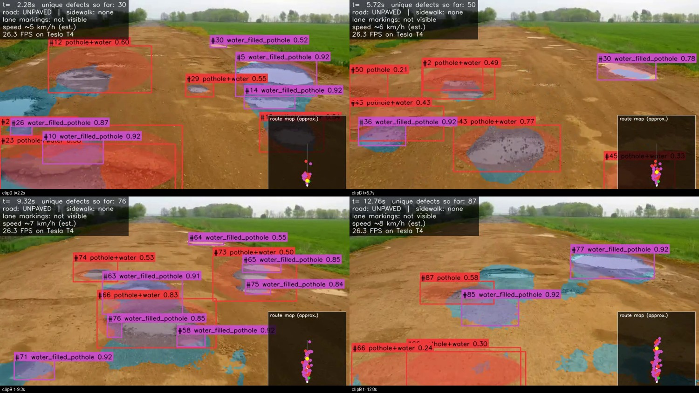
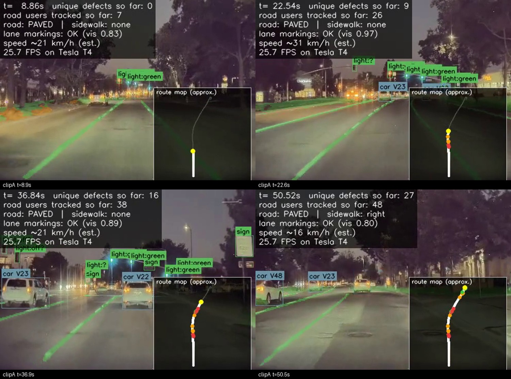
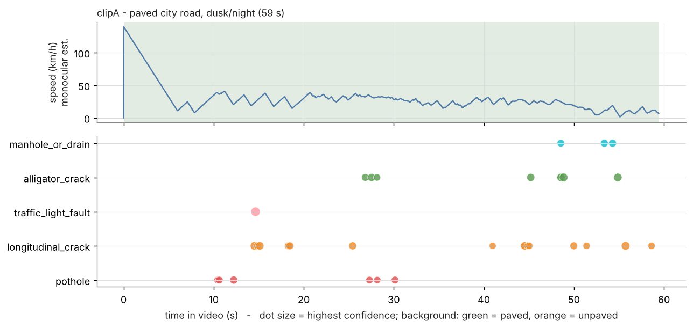
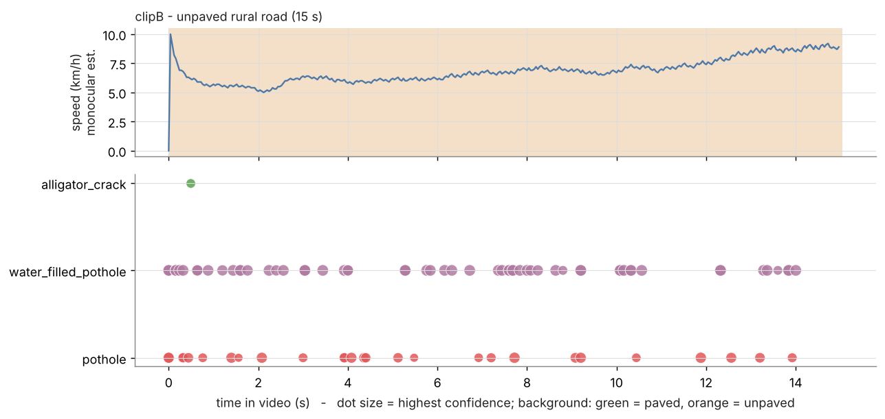
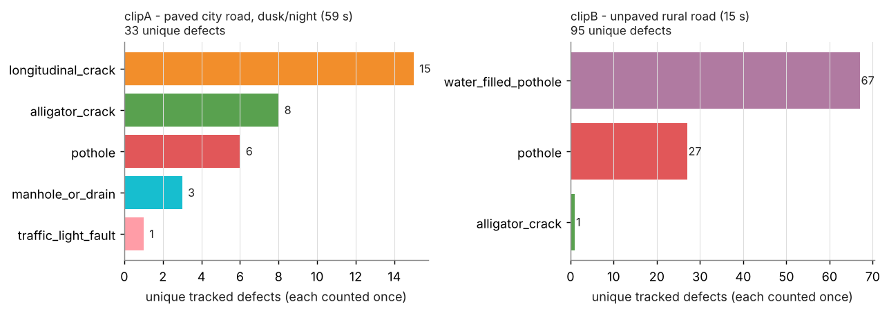
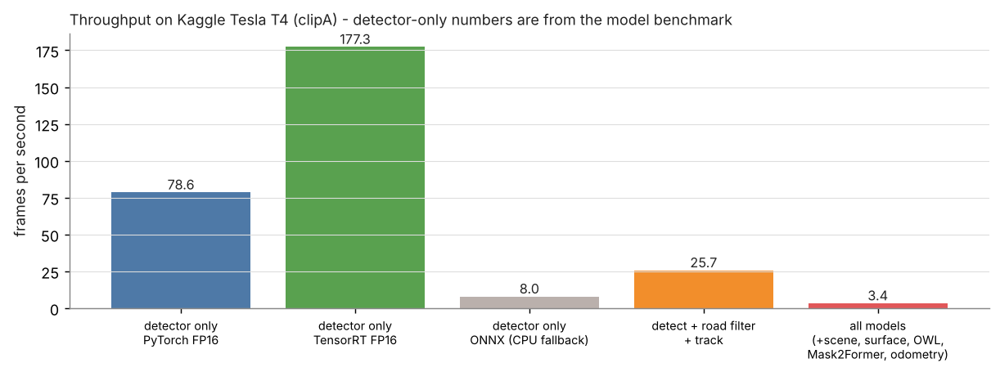
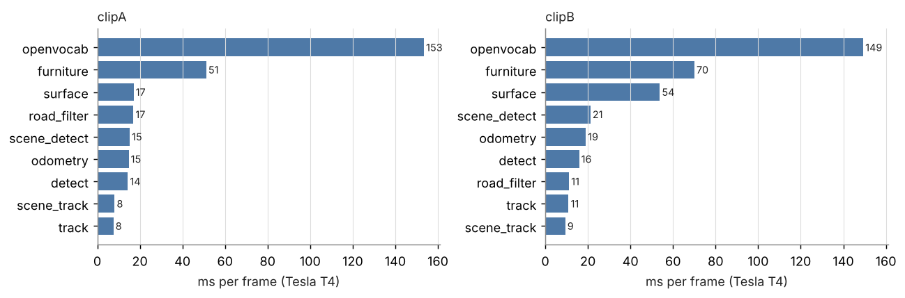
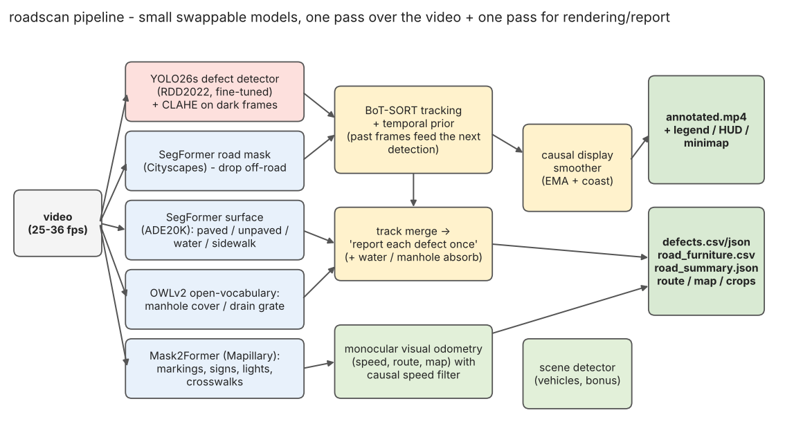
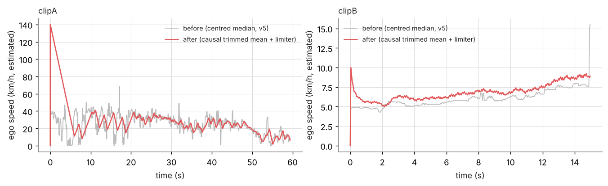
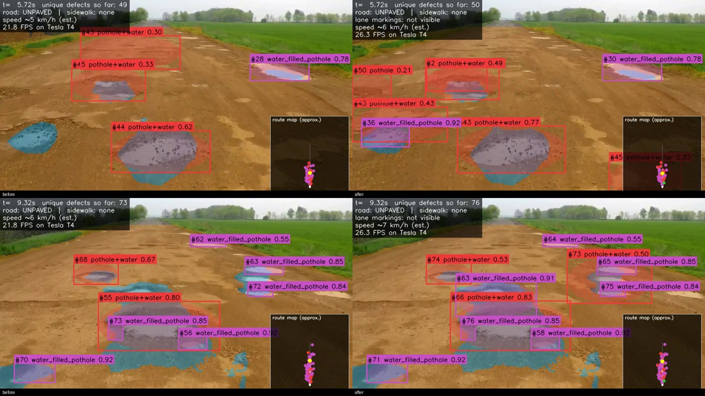

# Road-defect detection & road-condition analysis from dashcam video

> 🇪🇬 **النسخة العربية:** [README.ar.md](README.ar.md) &nbsp;|&nbsp; 📖 **How it was built, step by step:** [docs/JOURNEY.md](docs/JOURNEY.md) &nbsp;|&nbsp; 🛰️ **Jetson notes:** [docs/JETSON.md](docs/JETSON.md)

A pipeline that watches a road video and reports, **once per physical defect**: potholes, cracks (longitudinal / transverse /
alligator), water-filled potholes and manholes - with first-seen time, best confidence, a picture and a position on a
rough 2-D route map. It also tells you whether the road is paved or unpaved, whether a sidewalk exists, how fast the
vehicle was going, which vehicles it passed, and flags **possible problems** with lane paint, crosswalks, road signs and
traffic lights. Decisions are **stable** (no flicker) and use **past frames only**, as a deployed system must.

> ⚠️ The two input videos belong to the client and are **not** in this repository. The annotated outputs in `results/`
> contain their footage - keep this repository private.

> **Status of the results in this folder:** everything under `clipA/` and `clipB/` (annotated video, CSV / JSON, crops, images, route map,
> per-frame data in `frames/`) comes from **one run of the code in this repository (Kaggle notebook "Version 10", T4 x2, 28 min)** - the full-rate
> reference run plus the first Jetson-mode run (`jetson_10fps/`, with the clean original frames). `mode_comparison.md` compares the two.
> Older result sets are kept in `history/`. The Jetson-mode profiles with other frame-rate caps (24 / 18 / 12 FPS) are added by a later run and are
> listed in `mode_comparison.md` when present.

<p align="center">
  
  
</p>

## 1. What was asked → where to find it

| Required deliverable | File |
|---|---|
| Annotated video | [`results/clipA/annotated.mp4`](results/clipA/annotated.mp4), [`results/clipB/annotated.mp4`](results/clipB/annotated.mp4) |
| Defect table: track ID, type, first seen, highest confidence, image | `results/clip*/defects.csv` and `defects.json` (+ `images/`, `crops/`) |
| **Per-frame details** (every frame has its own record) | `results/clip*/frames/frame_summary.csv` (one row per frame), `frames/detections.csv` (one row per detection per frame), `frames/frames.jsonl` (full nested record per frame), `frames/img/frame_NNNNN.jpg` (the annotated frame) |
| FPS and hardware | section 3 below, `results/clip*/run_info.json`, `results/benchmarks/` |
| One-page README: approach, errors, improvements, Jetson | sections 4-8 below, [`docs/JETSON.md`](docs/JETSON.md) |
| Code | `roadscan/` (package), `scripts/`, `notebooks/`, `tests/` |
| *Extras we added* | road surface + sidewalk findings, vehicles log, route map, road-furniture inventory, stability layer |

## 2. Results

### clipA - paved city road at dusk/night (59.4 s, 496x368, 36 fps)

| clipA defect type | unique defects | mean best conf |
|---|---:|---:|
| longitudinal_crack | 21 | 0.59 |
| alligator_crack | 13 | 0.69 |
| pothole | 12 | 0.56 |
| manhole_or_drain | 3 | 0.59 |
| transverse_crack | 3 | 0.49 |
| traffic_light_fault | 1 | 1.00 |
| **total** | **53** | |

* Road: **paved** 100 % of the route, sidewalk on at least one side 57 % of the time.
* Road furniture looked at: **33 signs, 62 traffic lights, 2 crosswalks**; lane markings visible in 95 % of frames;
  **1** item flagged as *possible problem* (heuristic, see section 5).
* Route about 474 m at a mean ~29 km/h (monocular estimate, see limitations).
* Tracking: 82 raw tracks → **53 reported** after merge / filtering.



### clipB - unpaved rural road (15 s, 848x478, 25 fps)

| clipB defect type | unique defects | mean best conf |
|---|---:|---:|
| water_filled_pothole | 61 | 0.89 |
| pothole | 38 | 0.69 |
| alligator_crack | 3 | 0.60 |
| **total** | **102** | |

* Road: **unpaved** 100 %, no sidewalk, standing water ≈ 20 % of the visible road.
* Route about 24 m at ~6 km/h. Tracking: 239 raw tracks → **102 reported**.





## 3. Speed and hardware

| | value |
|---|---|
| GPU used | **Tesla T4 x2** (Kaggle), CPU Intel(R) Xeon(R) CPU @ 2.00GHz, PyTorch 2.11.0+cu128, CUDA 12.8 |
| detector only, PyTorch FP16 | 78.6 FPS (12.7 ms/frame) |
| detector only, **TensorRT FP16** | **177.3 FPS** (5.6 ms/frame) |
| detect + road filter + tracking (the "core") | **17.8 FPS** (clipA) / 17.6 FPS (clipB) - real time on a T4 |
| *all* models incl. surface, open-vocabulary, Mask2Former, scene, odometry | 3.1 FPS (clipA) / 2.6 FPS (clipB) - an offline / analysis mode |
| ONNX benchmark | 8 FPS - **not a model limit**: the onnxruntime-gpu wheel lacked `libcublasLt`, so it silently ran on CPU |




*Reading it*: the detector is not the bottleneck. The optional heavy models (OWLv2 ≈ 150 ms/frame, Mask2Former ≈ 50-70 ms/frame, run every 3rd / 4th frame) are. For real-time use switch them off or lower their cadence - the core runs at 18+ FPS.

### Which frame rate? (and what to run on a Jetson)

The same code was run in **two modes** (`scripts/run_video.py`, `--deploy-fps 24,18,12`):

* **Reference mode (offline)** - every frame: clipA 36 FPS, clipB 25 FPS. This produces `annotated.mp4` and the main tables.
* **Jetson mode** - the models see **at most N FPS** (a *cap*; `target_fps` picks the smallest stride that stays under it and rescales every frame-count parameter, including the "seen in >= N frames" report rule, to the analysed rate). Every analysed frame gets its own record and its own *original* frame with only the boxes drawn. Profiles tested: 10 FPS caps. No tested profile reaches 90 % recall and precision on both clips yet; the best recall is `jetson_10fps` (clipA stride 4 = **9.004 FPS**, clipB stride 2 = **12.5 FPS**); its frames are in `results/clip*/jetson_10fps/frames/`.

| clip | profile (cap) | analysis rate | stride | defects (reference) | defects (Jetson mode) | matched | only reference | only Jetson | recall | precision | core FPS (T4) | all-models FPS (T4) |
|---|---|---|---:|---:|---:|---:|---:|---:|---:|---:|---:|---:|
| clipA | 10 FPS | 9.004 FPS of 36.015 | 4 | 53 | 11 | 11 | 42 | 0 | 21% | 100% | 17.3 | 3.04 |
| clipB | 10 FPS | 12.5 FPS of 25.0 | 2 | 102 | 55 | 54 | 48 | 1 | 53% | 98% | 17.18 | 2.66 |

**No tested profile reaches 90 % recall and precision on both clips; best recall: `jetson_10fps`** (worst-clip recall 21%, precision 98%).

*How to read it*: **recall** = share of the reference defects that the Jetson mode also finds, **precision** = share of its defects that are also in the reference (both computed by `scripts/compare_modes.py`; a match = same class and overlapping visible time, +/-0.75 s). It is a *consistency* measure against our own full-rate run, not against human labels. Defects are on screen only briefly (median ~0.3 s on clipA, ~1 s on clipB at full rate), so the lower the frame rate the more of them are lost - a 10 FPS cap (stride 4 on clipA) kept every defect it reported (precision ~100%) but found only about a fifth of clipA's defects, which is why a 10 FPS cap is **not** enough. The cheap detector + tracker should therefore run at the highest rate the device allows, while the heavy models (open-vocabulary manholes, furniture segmentation, surface) run at a lower, fixed cadence. On the T4 the recommended profile runs the core (detector + road filter + tracking) at 17.3 FPS (clipA) / 17.18 FPS (clipB) and *all* models at 3.04 / 2.66 FPS. A Jetson is slower than a T4 - see [docs/JETSON.md](docs/JETSON.md) for the TensorRT plan; we did **not** measure on a Jetson.

### Per-frame output

`results/clip*/frames/` (reference, every frame: data only) and `results/clip*/jetson_10fps/frames/` (analysed frames: data **and** images):

| file | content |
|---|---|
| `frame_summary.csv` | one row per frame: time, road surface, sidewalk, lane-paint state / missing flag, speed, position, number of defects / road users / signs / lights / crosswalks |
| `detections.csv` | one row per object per frame: kind, track id, class, confidence, box (x1,y1,x2,y2) |
| `frames.jsonl` | the full nested record of each frame (defects, road users, road furniture, road state, ego motion) |
| `img/frame_NNNNN.jpg` | the **original frame** with the boxes of everything we track (no HUD, no legend, no map) |

All values are what a real-time system knows *at that frame* (past-only). The live map in `annotated.mp4` shows only the remembered trail (last 120 m) and the defects seen so far - never the rest of the route; `route_map.png` is a post-run summary for the report.

## 4. Approach



1. **Defect detector** - YOLO26s fine-tuned on RDD2022 (4 classes), image size 800, low confidence (0.15) on purpose: the tracker and report filters decide what survives.
   Optionally also run on a CLAHE-enhanced copy of dark frames and merge with NMS (`detect.enhance=auto`).
2. **Road mask** (SegFormer-B0, Cityscapes) - detections that are not on the road are dropped.
3. **Surface + sidewalk** (SegFormer-B0, ADE20K) - paved / unpaved / water / sidewalk per frame → segment table and plain-language findings; standing water on damaged ground becomes a *water-filled pothole* candidate.
4. **Manholes / drains** (OWLv2 open-vocabulary prompts on the road region); potholes lying on a manhole are absorbed into it.
5. **Road furniture** (Mask2Former, Mapillary) - lane markings, crosswalks, signs, traffic lights; condition cues voted over time.
6. **Tracking + "report once"** - BoT-SORT with camera-motion compensation, then a merge pass (fragments, duplicates, class vote, minimum frames/confidence).
7. **Visual odometry** (Lucas-Kanade on ground features + flat-ground model) → speed, route, map and the position of each defect.
8. **Stability layer** (all past-only) → section 6.

Why several small models instead of one big one: see [docs/JOURNEY.md](docs/JOURNEY.md#1-decisions-and-the-reasoning-behind-them) - each failure of the base detector is a different problem and there was no labelled data to retrain on.

## 5. Errors we saw (and what they mean)

* **Night / low-resolution asphalt (clipA)**: RDD2022 is daylight imagery, so recall on thin cracks and shallow holes is lower than on clipB. A CLAHE ensemble raised raw detections by ~44 % in a 250-frame test, but without labels we cannot say how much of that is real.
* **Manholes look like potholes in the dark** → handled by absorbing potholes that sit on a manhole/drain track.
* **Counting**: unique counts depend on the merge rule; clipB is a field of overlapping potholes, so "102 unique defects" is a lower-bound-style estimate, not ground truth. We have no hand-labelled reference, so **no precision/recall is claimed**.
* **Sign / light / paint verdicts are heuristics** (lean, lamp colour, contrast), reported as *possible problem*. CLIP on tiny sign crops is noise and is disabled below 40 px.
* **Odometry is monocular**: speed and distances scale with an assumed camera height (1.4 m) and FOV (75°); treat them as rough. The first seconds of a clip have no flow history.
* **Causal smoothing costs latency**: state changes are shown ~1-2 s late - the price of not looking into the future.

## 6. Stability ("no flicker, past only")



* A defect is **drawn only once confirmed** (EMA score with on/off hysteresis, ≥ 2 hits), coasts a few frames through a missed detection, and the box coordinates and the confidence label are smoothed - `DisplaySmoother`.
* The previous confirmed tracks **feed back into the next detection step** (`TemporalPrior`: confidence blend and a class vote inside the crack group; 421 detections boosted on clipA) - the left-only "attention window" the task asked for.
* **Speed** uses a causal trimmed mean → EMA → acceleration/deceleration limiter with a start-up guard, so 40 → 0 → 40 km/h dips cannot happen; surface and sidewalk states change only after they persist 1.5 s.
* Before / after (previous run vs. this one):



**Colour key** (also drawn on the video): coloured boxes = defect class (see the legend), light-orange tint = unpaved ground, thin green box = sign / light / crosswalk judged OK, red = *possible problem*, **lane paint is traced green when it is visible and fine and red when it is worn/faded**, and the HUD shows a red *MISSING - possible problem* line when a paved road shows no paint for 3 s in a row (past frames only).

## 7. How to improve it

1. Hand-label ~100 frames per clip → real precision/recall, threshold tuning per class.
2. Fine-tune on night / low-resolution / unpaved data and on water-filled potholes (the largest gap).
3. Replace the sign / light heuristics by a small classifier trained on a few hundred crops.
4. Metric scale from lane width (or GPS/IMU) instead of an assumed camera height.
5. Evaluate RF-DETR-S (prepared, notebook 02) as a challenger.
6. Cadence tuning: surface every 3-5 frames, OWLv2 only when the surface is paved, Mask2Former every 8 frames.

## 8. Running on a Jetson

TensorRT FP16 on the device (`yolo export format=engine half=True`), road mask every 3-5 frames, SAM only on each defect's best frame, GStreamer/NVDEC decode, headless mode writing CSV/JSON + crops only. Full guide: [docs/JETSON.md](docs/JETSON.md). *We measured the T4 only; Jetson figures in the guide are reference values, not our measurements.*

## 9. Reproduce

```bash
pip install -r requirements.txt
# 1) detector weights: train with scripts/train_yolo.py (notebooks/01_train_yolo26_kaggle.ipynb) or use your own
python scripts/run_video.py my_video.mp4 --weights weights/yolo26s_rdd.pt --out outputs \
       --scene --openvocab --furniture            # --sam for masks, --no-temporal to compare
python scripts/make_figures.py --results outputs --out docs/images
python -m pytest -q tests                          # 28 unit tests (temporal logic, tracking merge, furniture helpers)
```

Kaggle: `notebooks/03_infer_videos_kaggle.ipynb` (inference), `01_train_yolo26_kaggle.ipynb` / `04_finetune_yolo26_kaggle.ipynb` (training), runbook in [docs/KAGGLE_RUNBOOK.md](docs/KAGGLE_RUNBOOK.md).

## 10. Repository map

```
roadscan/            detectors.py  tracking.py  temporal.py  furniture.py  surface.py  openvocab.py  odometry.py
                     mapping.py  vehicles.py  road_mask.py  render.py  export.py  pipeline.py  config.py
scripts/             run_video.py  benchmark.py  sweep.py  train_yolo.py  prepare_data.py  make_figures.py  make_gallery.py
notebooks/           01 train · 02 RF-DETR (challenger) · 03 inference · 04 fine-tune (generated by make_notebooks.py)
tests/               28 unit tests
results/             final outputs per clip + benchmarks + history of earlier runs (results/history)
docs/                JOURNEY(.ar).md · JETSON.md · KAGGLE_RUNBOOK.md · images/
```

## 11. Credits & licences

Ultralytics YOLO26 (AGPL-3.0), RDD2022, SegFormer (NVIDIA), Mask2Former (Meta / Mapillary Vistas weights), OWLv2 (Google), BoT-SORT, SAM 2 (Meta), OpenCV. Check each model's licence before commercial use.
